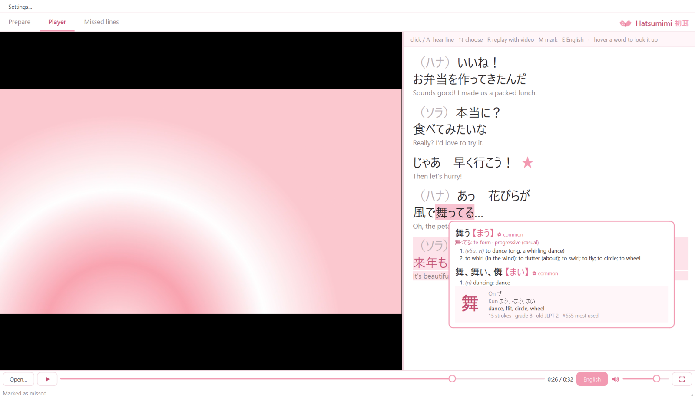
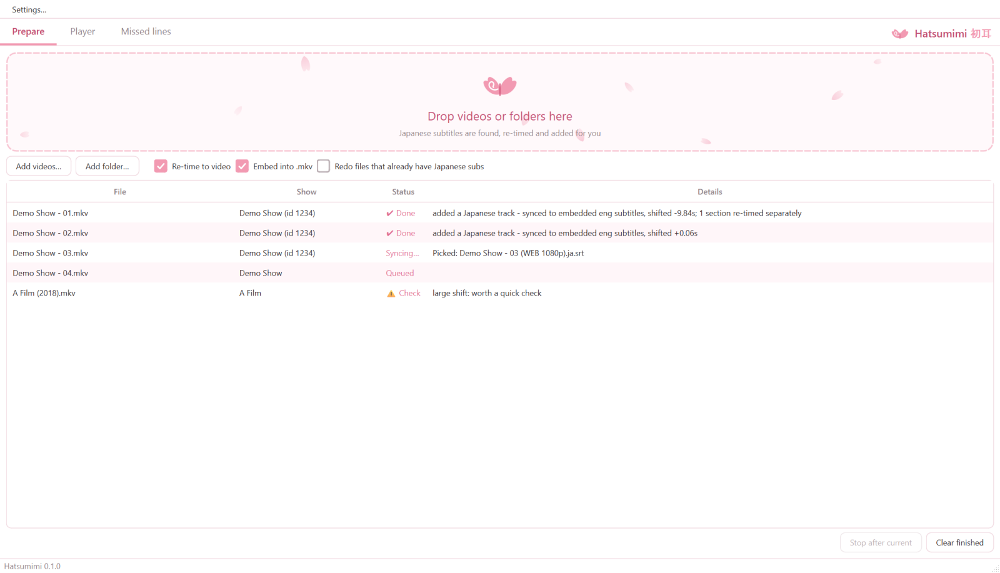
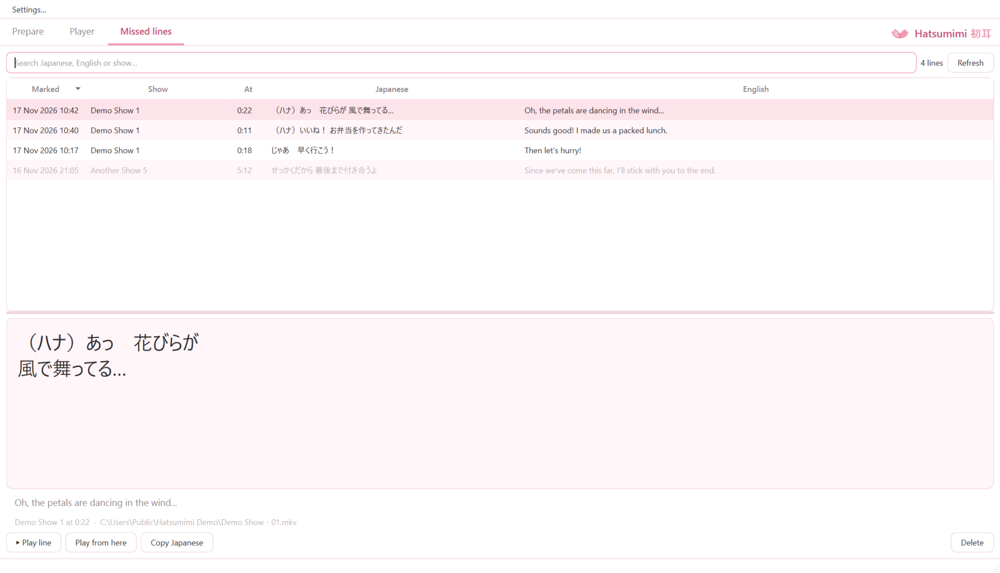
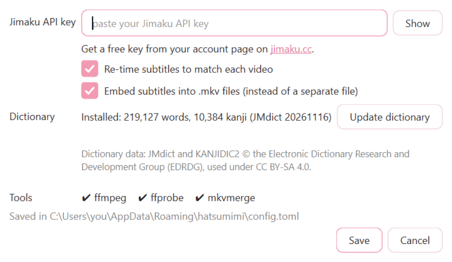

<p align="center">
  
</p>

<h1 align="center">Hatsumimi 初耳</h1>

<p align="center"><b>Learn Japanese by listening: watch without subtitles, and check the lines only when you pause.</b></p>

*Hatsumimi* (初耳) means "hearing something for the first time". Subtitles are great for understanding a show but terrible for training your ear: once they're on, you read instead of listen. Turn them off and one unfamiliar phrase can lose you the whole scene.

Hatsumimi sits in between. You watch with **no subtitles on screen**. When you miss something, **pause**: the video slides aside and the last few lines appear in Japanese, with the English underneath. Hear any line again, hover a word to look it up, mark lines you missed, and press play.



## Features

- **Prepare your videos.** Drop episodes or whole folders in. Hatsumimi finds Japanese subtitles on [Jimaku](https://jimaku.cc), downloads them, re-times them to *your* copy of the video, and embeds them into the `.mkv`.
- **Pause panel.** Subtitles stay hidden while you watch. Pause, and the last five lines appear beside the video: Japanese, English underneath, speaker names dimmed.
- **Hear a line again (audio only).** Click a line or press **A**: just that line's audio plays, and the paused video doesn't move. **R** replays it with the video.
- **Hover dictionary.** Point at any word for a Rikaikun-style popup, offline. It recognises conjugations (作れる → 作る, potential) and includes a kanji card.
- **Missed lines.** Press **M** to save a line. The *Missed lines* tab lists them all, searchable, and plays any of them back in context.
- **Smart re-timing.** Jimaku subtitles are often timed for a TV broadcast, so the cold open matches but everything after the opening is 10 s out. Hatsumimi fixes the timing section by section.
- **A proper player.** Built on mpv, it handles MKV, HEVC and styled ASS subtitles. Fullscreen with auto-hiding controls, click to pause, click anywhere on the seek bar to jump.

<table>
<tr>
<td></td>
<td></td>
</tr>
<tr>
<td align="center"><i>Prepare: drop videos or folders</i></td>
<td align="center"><i>Missed lines: review and replay</i></td>
</tr>
</table>

## Download and install

### Windows

1. Download **`Hatsumimi-windows.zip`** from the [latest release](https://github.com/worldofpayne/hatsumimi/releases/latest) and extract it anywhere.
2. Install the two tools Hatsumimi uses for preparing videos:
   ```
   winget install Gyan.FFmpeg MKVToolNix.MKVToolNix
   ```
3. Run **`Hatsumimi.exe`** from the extracted folder.
   - The app isn't code-signed, so Windows may show *"Windows protected your PC"*. Choose **More info → Run anyway**.

Optional: to add Start menu and desktop shortcuts, install from a copy of this repository instead (see [Building](#building)), then run `packaging\windows\install.ps1 -Desktop`.

### Arch Linux / Omarchy

```
git clone https://github.com/worldofpayne/hatsumimi.git
cd hatsumimi
./packaging/linux/install.sh
```

The script:
- installs any missing packages with pacman (`uv`, `mpv` for libmpv, `ffmpeg`, `mkvtoolnix-cli`), asking for your password;
- installs Hatsumimi as the `hatsumimi` command (with `uv tool`, in its own environment);
- adds a launcher entry and icon, so it appears in your app launcher and under *Open with* for videos.

It uses your system's libmpv and Qt Wayland support. To update, `git pull` and run the script again.

### Other Linux

Install `uv`, `mpv` (or `libmpv`), `ffmpeg` and `mkvtoolnix` with your package manager, then from the cloned folder:
```
uv tool install --python 3.12 .
hatsumimi
```

## First launch



1. **Jimaku API key:** create a free account at [jimaku.cc](https://jimaku.cc), copy the API key from your account page, and paste it into **Settings**.
2. **Dictionary:** in Settings, choose **Download dictionary**. It's about 13 MB, builds in about 15 seconds, and works offline after that.
3. **Tools:** Settings shows ✔ or ✖ for ffmpeg, ffprobe and mkvmerge, with the install command if any are missing.

## Using Hatsumimi

### 1. Prepare

Drop video files or whole folders onto the **Prepare** tab (sub-folders included), or use *Add videos…* / *Add folder…*. For each video, Hatsumimi:

1. reads the show, season and episode from the filename;
2. finds the show on Jimaku. If several entries match, for example different seasons, it asks once and remembers your choice for that folder;
3. picks the episode's subtitle file, preferring plain dialogue over closed captions, and opening `.zip` / `.7z` packs when needed;
4. converts it to UTF-8 (Japanese subtitles are often Shift-JIS);
5. **re-times it** against the video's English subtitle track (or its audio if there isn't one), first as a whole, then section by section;
6. **embeds it** into the `.mkv` as a track called *Japanese (Hatsumimi)*. Nothing is re-encoded, and the original file is only replaced after the new one checks out.

The table shows each file's progress: ✔ Done, ⚠ Check (e.g. a suspiciously large time shift, left as a separate file for you to check), ✖ Failed (with the reason). Double-click a finished file to play it.

| Option | |
|---|---|
| Re-time to video | sync the subtitles to your copy (recommended) |
| Embed into .mkv | add the subtitles to the video file instead of a separate `.ja.srt` |
| Redo files that already have Japanese subs | prepare them again, e.g. after an update |

### 2. Watch

Open a video from the **Player** tab, by dropping it on the window, or by double-clicking it in Prepare. Videos with a Japanese track play with **subtitles hidden**. Pause whenever you lose the thread.

| Key / mouse | Action |
|---|---|
| Space, click the video | play / pause |
| ← / → | seek 5 s |
| click a line, or **A** | **hear** that line again: audio only, the video stays paused |
| ↑ / ↓ | choose a line in the panel |
| **R** | replay the chosen line *with video*, then pause again |
| **M** | mark the line as missed (★) |
| **E** | show / hide the English |
| hover a word | dictionary popup |
| F, double-click the video | fullscreen (Esc to leave) |
| mouse wheel on the video | volume |

In fullscreen, the cursor and controls hide while the video plays and reappear when you move the mouse. Videos without a Japanese track play like in any normal player.

### 3. Review

The **Missed lines** tab lists every line you've marked, newest first.
- **Search** across the Japanese, the English and the show name.
- **▶ Play line** (or Enter / double-click) plays just that line in context.
- **Play from here** watches on from that point.
- **Copy Japanese** copies the selected lines, e.g. for flashcards.
- **Delete** (or Del) removes lines; **Ctrl+Z** brings them back.

The hover dictionary works here too.

## Command-line tools

Installed alongside the app (with `uv tool`, or with `uv run …` from the project folder):

| Command | What it does |
|---|---|
| `hatsumimi [video.mkv]` | start the app, optionally opening a video |
| `fetch-subs <files or folders> [-r] [-f] [--no-sync] [--no-mux] [--entry-id N]` | the Prepare step without the window |
| `hatsumimi-dict` | download and build the dictionary |
| `install-mpv-script` | install the pause panel as a script for standalone **mpv** |
| `hatsumimi --self-test report.txt` | check that a build works (parsing, dictionary, archives, libmpv, sync) |

**Standalone mpv:** `install-mpv-script` adds a simpler version of the pause panel to your normal mpv (↑↓ choose, R replay, M mark, E English). Lines marked there show up in Hatsumimi's Missed lines tab too.

## Where things are stored

| | Windows | Linux |
|---|---|---|
| Settings | `%APPDATA%\hatsumimi\config.toml` | `~/.config/hatsumimi/config.toml` |
| Missed lines | `%APPDATA%\hatsumimi\missed.jsonl` | `~/.local/share/hatsumimi/missed.jsonl` |
| Dictionary | `%APPDATA%\hatsumimi\dict\` | `~/.local/share/hatsumimi/dict/` |

Next to your videos, a `.hatsumimi` folder remembers which Jimaku show each folder is and keeps the original downloaded subtitles.

## Building

Requires [uv](https://docs.astral.sh/uv/).

```
git clone https://github.com/worldofpayne/hatsumimi.git
cd hatsumimi
uv sync
uv run hatsumimi            # run from source
```

**Windows release build.** The player needs `libmpv-2.dll`: download `mpv-dev-x86_64-*.7z` from [shinchiro/mpv-winbuild-cmake releases](https://github.com/shinchiro/mpv-winbuild-cmake/releases), extract `libmpv-2.dll` with 7-Zip into `vendor\libmpv\`, then:

```
powershell -ExecutionPolicy Bypass -File packaging\windows\build.ps1
powershell -ExecutionPolicy Bypass -File packaging\windows\install.ps1 -Desktop
```

The first command makes `dist\Hatsumimi\` and `dist\Hatsumimi-windows.zip`. The second installs the build to `%LOCALAPPDATA%\Programs\Hatsumimi` with Start menu (and `-Desktop`) shortcuts. Close the app before reinstalling.

On Linux, `packaging/linux/install.sh` installs from source, as above.

## Troubleshooting

- **"Windows protected your PC":** the app isn't code-signed. Choose *More info → Run anyway*.
- **A ✖ for a tool in Settings:** install it (`winget install Gyan.FFmpeg MKVToolNix.MKVToolNix`, or `sudo pacman -S ffmpeg mkvtoolnix-cli`) and restart Hatsumimi.
- **Subtitles slightly out of sync:** re-prepare the file with *Redo files…* ticked. If the timing is still off, the Jimaku file may be for a very different cut; try another subtitle file with `fetch-subs <file> -f --entry-id N`.
- **"No Japanese subtitle track":** the video hasn't been prepared yet; drop it on the Prepare tab first.
- **Logs:** `mpv.log` and `app.log` are in the settings folder above.

## Credits and licences

Hatsumimi is free software under the **GNU General Public License v3.0 or later** (see [LICENSE](LICENSE)).

It builds on:
- [mpv / libmpv](https://mpv.io) (GPL; the Windows download bundles a [shinchiro](https://github.com/shinchiro/mpv-winbuild-cmake) libmpv build) via [python-mpv](https://github.com/jaseg/python-mpv);
- [Qt / PySide6](https://www.qt.io/qt-for-python) (LGPL);
- [ffsubsync](https://github.com/smacke/ffsubsync) (MIT) for subtitle synchronisation;
- [guessit](https://github.com/guessit-io/guessit) (LGPL) for filename parsing;
- [MKVToolNix](https://mkvtoolnix.download) and [FFmpeg](https://ffmpeg.org), used as external tools;
- [Jimaku](https://jimaku.cc) for Japanese subtitles.

**Dictionary data:** [JMdict](https://www.edrdg.org/jmdict/j_jmdict.html) and [KANJIDIC2](https://www.edrdg.org/wiki/index.php/KANJIDIC_Project) © the Electronic Dictionary Research and Development Group, used under [CC BY-SA 4.0](https://www.edrdg.org/edrdg/licence.html), via [jmdict-simplified](https://github.com/scriptin/jmdict-simplified). It's downloaded on first use, not included in this repository. The conjugation rules are Hatsumimi's own.

The screenshots use a demo video with original dialogue written for this project.
